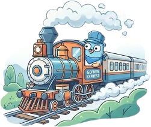

# go-train-framework



[](https://github.com/Shitcode-Swamp/go-train-framework/releases/latest)

Custom framework made in edutcational puposes.

## Roadmap

| Status     | Feature              | Description                                                                                |
| ---------- | -------------------- | ------------------------------------------------------------------------------------------ |
| ✅ Done    | Dependency Injection | Auto-wires `AppContext` fields, constructors, and getters from `@Injection`/`@Inject` tags |
| 🔜 Planned | Controllers codegen  | Controller  codegen by folders paths (spec idea turned out non-convenient)                                            |
| 🔜 Planned | gRPC codegen         | Generate gRPC service stubs from a shared spec repo                                        |

## Overall description

Framework automaticaly builds AppCtx with needed dependencies
To use the framework build tool you might run binary via
`chmod +x ./build/go-train && ./build/go-train` or `run.sh`

You must describe what directory to watch via flag `--root=path`

How the framework is built is descrived in the `structure.excalidraw`

## DI tags

Two comment annotations drive the generator:

- `@Injection(token)` — goes on a constructor function's doc comment. Marks it
  as a dependency to include in `AppContext`, keyed by `token`.
- `@Inject(token)` — goes on a constructor parameter (as an inline `/* ... */`
  comment). Marks that parameter as needing another `@Injection`-tagged
  dependency, resolved by its `token`.

```go
// @Injection(testInjectee)
func InitInjectee() *TestStruct {
	return &TestStruct{}
}

// @Injection(test)
func Init(
	testField interface{} /* @Inject(testInjectee) */,
) *TestStruct {
	return &TestStruct{
		TestField: testField,
	}
}
```

Running the tool over a directory containing both produces something like:

```go
type AppContext struct {
	testInjectee *pkg.TestStruct
	test         *pkg.TestStruct
}

func NewAppContext() *AppContext {
	testInjectee := pkg.InitInjectee()
	test := pkg.Init(testInjectee)
	return &AppContext{
		testInjectee: testInjectee,
		test:         test,
	}
}
```

Dependency order is resolved automatically — you don't need to declare `Init`
before `InitInjectee`, or worry about wiring them together by hand.

### Flags

`@Injection(token, flag-one, flag-two)` accepts optional comma-separated
flags after the token to opt out of parts of the generated code for that
dependency:

- `no-getter` — don't generate an `AppContext` getter method for it. The
  field is still populated and wired into the constructor, it's just not
  exposed via a getter.

```go
// @Injection(internalCache, no-getter)
func NewCache() *Cache {
	return &Cache{}
}
```

## Using it as a Go tool in other repos

The command lives at `cmd/go-train` so it can be installed like any other Go tool.

**Global install** (puts `go-train` on your `$GOBIN`/`$GOPATH/bin`):

```sh
go install github.com/Shitcode-Swamp/go-train-framework/cmd/go-train@latest
go-train -root=./path/to/watch -ctxPath=./path/to/output
```

**As a per-module tool dependency** (Go 1.24+, pins the version in the consuming
repo's `go.mod` via a `tool` directive):

```sh
go get -tool github.com/Shitcode-Swamp/go-train-framework/cmd/go-train@latest
go tool go-train -root=./path/to/watch -ctxPath=./path/to/output
```

While developing locally without a published module, point a consuming repo's
`go.mod` at your local checkout instead:

```go
replace github.com/Shitcode-Swamp/go-train-framework => /path/to/go-train-framework
```
